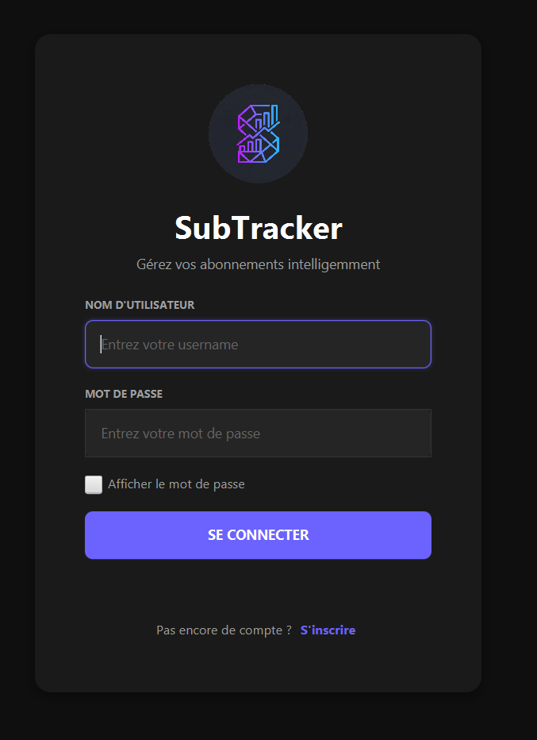
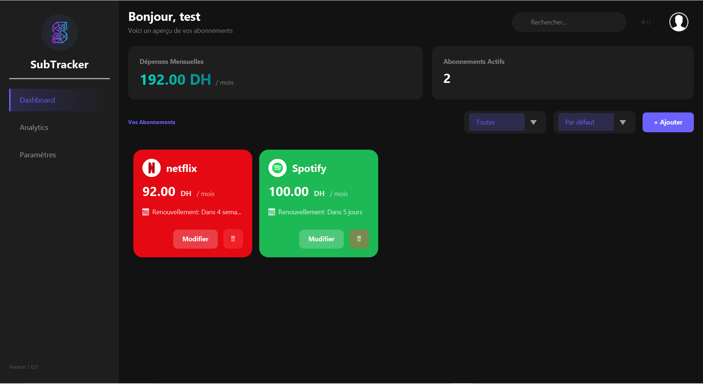
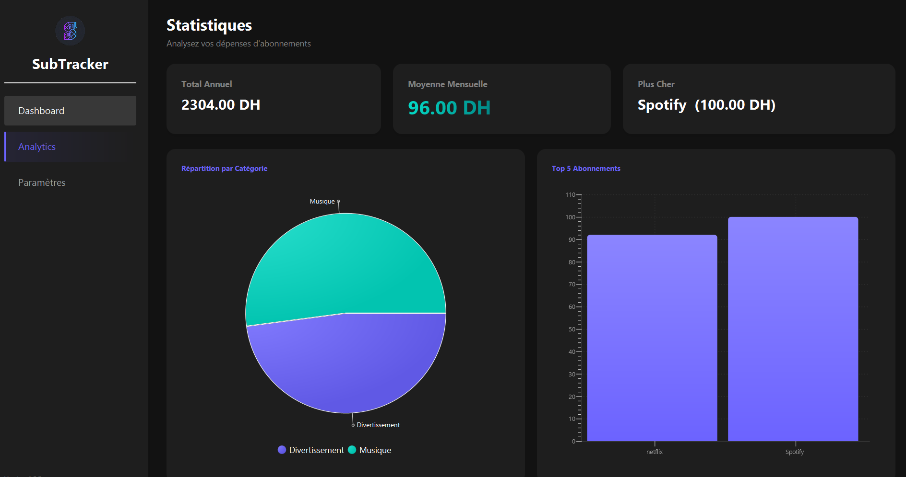
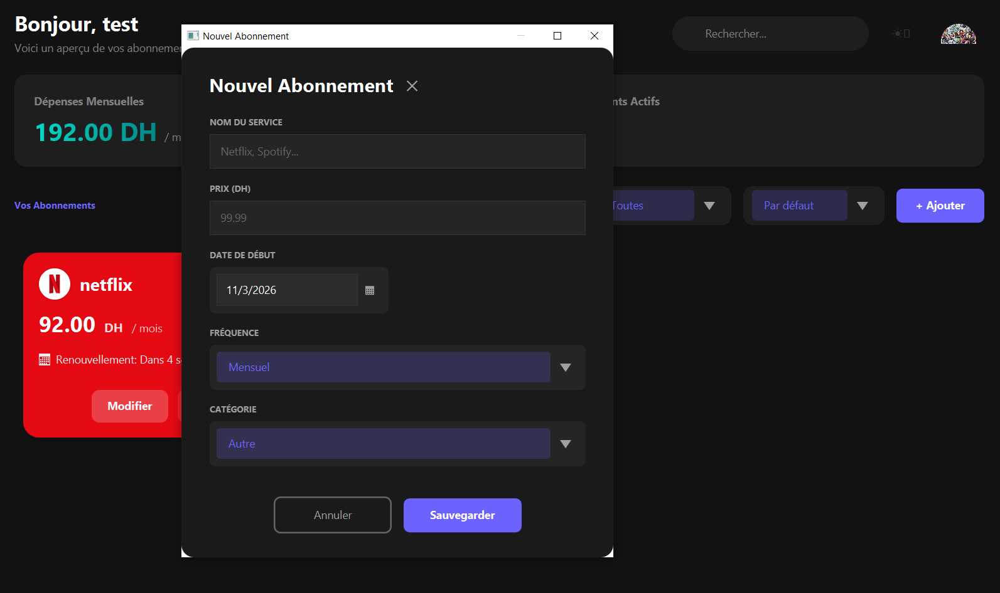
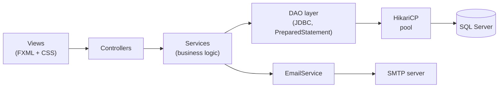

# SubTracker

**A JavaFX desktop application to track, analyse and manage your subscriptions** (streaming, software, cloud, gym…), with individual and family accounts, spending analytics and e-mail renewal reminders.


---

## ✨ Features

- **Authentication**: registration and login, passwords hashed with **BCrypt**.
- **Individual and family accounts**: a family account can create member profiles with their own login, and subscriptions can be assigned to a member.
- **Subscription management**: add, edit and delete subscriptions (monthly or yearly), with categories you can customise.
- **Service catalogue**: pick well-known services from a built-in catalogue; logos and brand colours are fetched automatically.
- **Dashboard**: active subscriptions and monthly spending at a glance (amounts in DH).
- **Analytics**: pie and bar charts to see where your money goes.
- **Renewal reminders by e-mail (SMTP)**: a welcome e-mail at sign-up and an alert 3 days before a renewal.
- **Settings**: dark / light theme, currency, profile picture and password change.

## 📸 Screenshots

<!-- TODO: add your screenshots in docs/screenshots/ and keep or rename these paths -->

| Login | Dashboard |
|---|---|
|  |  |

| Analytics | Add a subscription |
|---|---|
|  |  |

## 🧰 Tech stack

| Area | Technologies |
|---|---|
| Language | Java 21 |
| UI | JavaFX 21, FXML, CSS |
| Database | Microsoft SQL Server, JDBC (`mssql-jdbc`), HikariCP connection pool |
| Security | BCrypt (jBCrypt) |
| E-mail | Jakarta Mail (SMTP) |
| Build | Maven |

## 🏗️ Architecture

The application follows a layered architecture (MVC with a service and DAO layer).



```
src/main/java/com/emsi/subtracker/
├── config/        # database and e-mail configuration
├── controllers/   # JavaFX controllers (login, dashboard, analytics, settings…)
├── services/      # business logic (users, subscriptions, family, e-mail, branding)
├── dao/           # data access interfaces and JDBC implementations
├── models/        # User, Abonnement, FamilyMember…
└── utils/         # DB connection, session, scene and theme managers, PasswordUtil
```

## 🚀 Getting started

### Prerequisites

- **JDK 21**
- **Maven 3.9+**
- **Microsoft SQL Server** (Express or Developer edition) and a client such as SSMS or Azure Data Studio

### 1. Clone the project

```bash
git clone https://github.com/YacineDaher/subtracker.git
cd subtracker
```

### 2. Create the database

Run [`database/schema.sql`](database/schema.sql) in SSMS or Azure Data Studio. It creates the `subtracker_db` database and all tables. The script is safe to re-run.

### 3. Configure the application


- **`database.properties`** (required): your SQL Server URL, user and password.
- **`mail.properties`** (needed only for e-mail notifications): a Gmail address and a [Google app password].

### 4. Run

```bash
mvn clean compile
mvn javafx:run
```

Create an account from the registration, then log in.

### Troubleshooting SQL Server connection

If the app fails with a *connection timed out* error:

1. In **SQL Server Configuration Manager**, enable **TCP/IP** for your instance.
2. In the TCP/IP properties, open the **IP Addresses** tab, go to **IPAll**, clear *TCP Dynamic Ports* and set *TCP Port* to `1433`.
3. Restart the SQL Server service.
4. Use the port explicitly in `database.properties`:
   ```
   db.url=jdbc:sqlserver://localhost:1433;databaseName=subtracker_db;encrypt=true;trustServerCertificate=true;
   ```

## 🔐 Security notes

- Passwords are stored as **BCrypt** hashes.
- All SQL queries use `PreparedStatement`.
- Credentials live in git-ignored files (`database.properties`, `mail.properties`).

## 👥 Team

Group project realised at **EMSI Casablanca** with a team , supervised by **Mr. Badr Hirchoua**:


